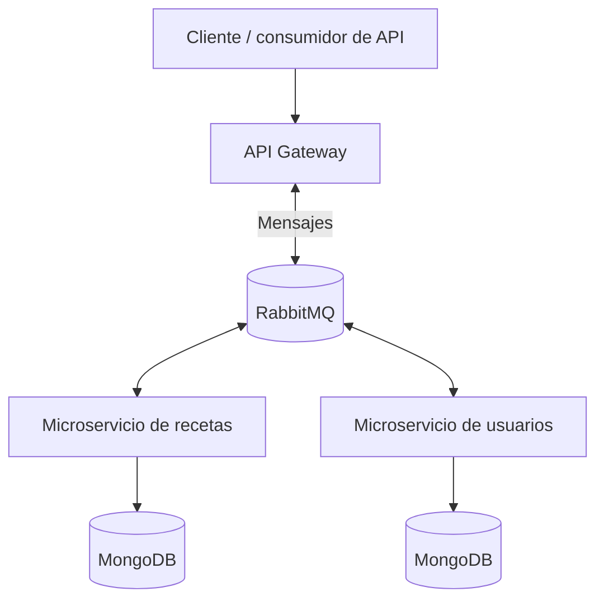

# 🍳 Remi Recetas

**Remi Recetas** es un proyecto de backend para una plataforma de recetario digital, desarrollado con una arquitectura de microservicios. Separa el punto de entrada de la aplicación, la gestión de recetas y la gestión de usuarios en servicios independientes.

## 🧰 Tecnologías

- **NestJS 11**, **Node.js** y **TypeScript**: desarrollo de la API y los microservicios.
- **RabbitMQ**: mensajería y comunicación entre servicios.
- **MongoDB** y **Mongoose**: persistencia de datos en los microservicios.
- **JWT**, **Passport** y **bcrypt**: tecnologías utilizadas en el componente de usuarios para autenticación y protección de credenciales.
- **Docker**: archivos de configuración para contenerizar servicios.

## 🏗️ Arquitectura



> Esquema conceptual de los componentes. La configuración y los canales concretos de comunicación deben consultarse en cada repositorio.

## 📦 Repositorios

| Componente | Responsabilidad | Código fuente |
| --- | --- | --- |
| **API Gateway** | Punto de entrada a la plataforma y coordinación de solicitudes | [remirecetas-gateway](https://github.com/sharkedd/remirecetas-gateway) |
| **Microservicio de recetas** | Lógica de negocio y persistencia de recetas | [remireceta-ms-recetas](https://github.com/sharkedd/remireceta-ms-recetas) |
| **Microservicio de usuarios** | Gestión de usuarios y componentes de autenticación | [remireceta-ms-users](https://github.com/sharkedd/remireceta-ms-users) |

## 🎯 Objetivo técnico

Explorar el diseño de sistemas distribuidos y la separación de responsabilidades mediante servicios independientes, integrando mensajería, bases de datos NoSQL y prácticas de desarrollo backend modular.

## 🚀 Ejecución local

Cada componente se mantiene en su propio repositorio. Para ejecutarlo, revisa el archivo `.env.example`, las dependencias y las instrucciones del repositorio correspondiente.

```bash
# Ejemplo: obtener el API Gateway
 git clone https://github.com/sharkedd/remirecetas-gateway.git
 cd remirecetas-gateway
 npm install
 npm run start:dev
```

La ejecución completa requiere configurar también los microservicios y las dependencias externas (por ejemplo, RabbitMQ y MongoDB). Este repositorio funciona como **documentación central**; no incluye todavía un `docker-compose.yml` verificado para iniciar toda la plataforma.

## 👨‍💻 Autor

**José Miguel Carrillo Rojas** — [GitHub @sharkedd](https://github.com/sharkedd)
